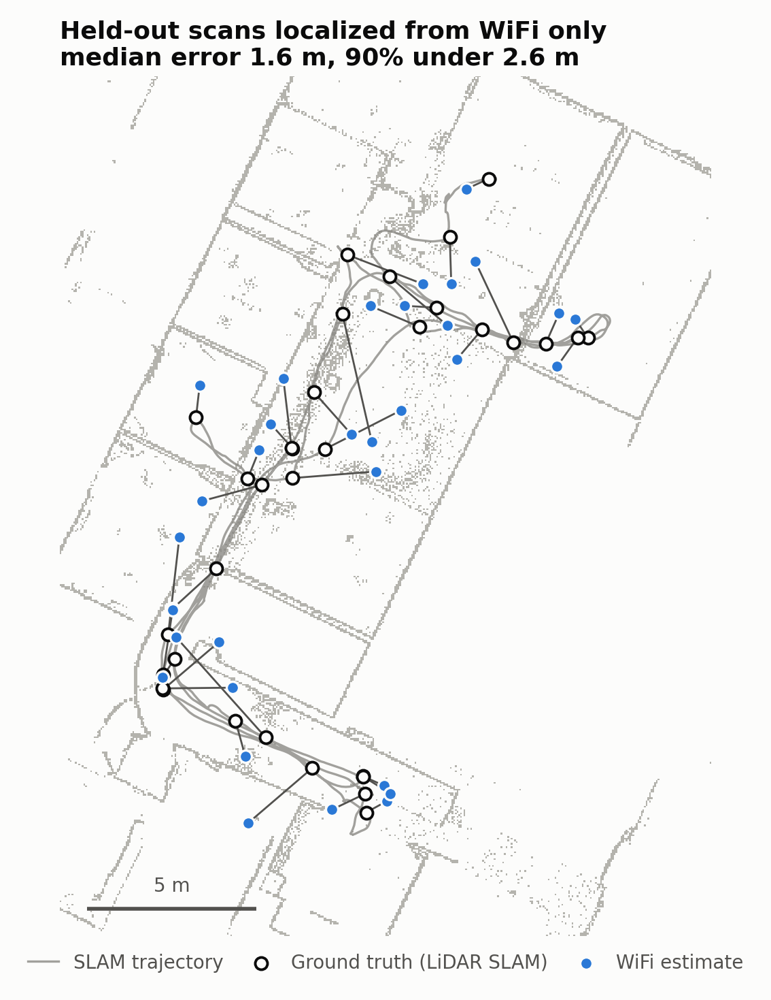
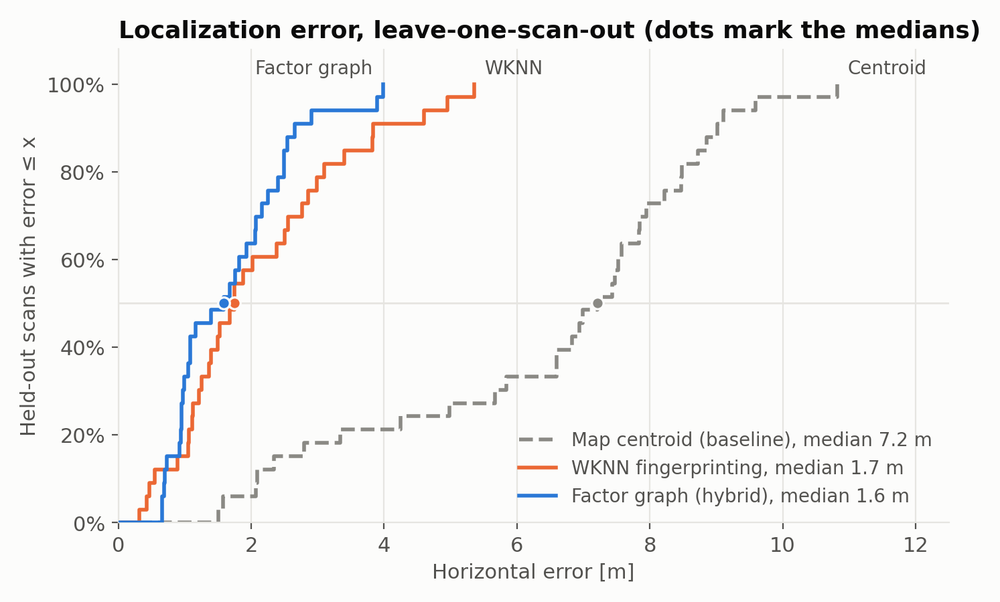
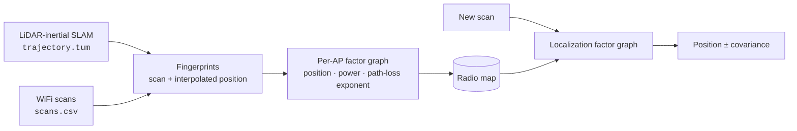
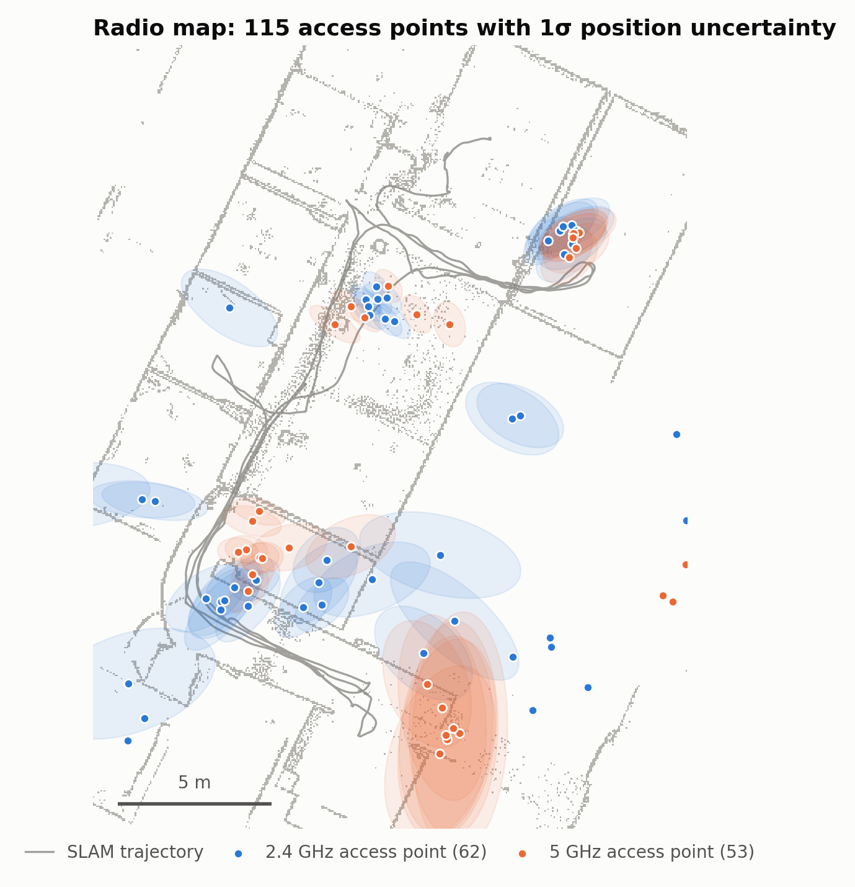

<h1 align="center">WiFiFP-Nav</h1>

<p align="center">
  <b>Indoor WiFi localization with factor graphs, trained by a single LiDAR-SLAM walk.</b><br>
  Walk a building once with a LiDAR and a WiFi adapter. After that, any WiFi scan is enough to say where you are.
</p>

<p align="center">
  <a href="https://github.com/catenacciA/WiFiFP-Nav/actions/workflows/ci.yml"></a>
  
  
  <a href="LICENSE"></a>
</p>

<p align="center">
  <picture>
    <source media="(prefers-color-scheme: dark)" srcset="docs/img/localization-dark.png">
    
  </picture>
</p>

## What it does

WiFiFP-Nav turns one survey walk into a **radio map**. The walk is a LiDAR-SLAM trajectory plus
periodic WiFi scans, and the map holds a fitted signal model for every access point. From then on it
**localizes a device from a single WiFi scan**, with no LiDAR and no extra infrastructure.

- Each scan is positioned by interpolating the SLAM trajectory at its timestamp.
- Each access point gets a log-distance path-loss model, fitted as a robust factor graph in
  [GTSAM](https://github.com/borglab/gtsam) with real covariances.
- Localization is MAP inference in a second factor graph, which accounts for how well each AP was mapped.
- `wififp benchmark` measures accuracy against the LiDAR ground truth. CI runs it on every push.

## Results

Leave-one-scan-out on the [bundled office dataset](data/README.md) (33 scans, 115 access points,
127 m walk). Each scan is held out in turn and localized against a map built from the others.

| Method | Median error | 90th pct. | Max |
|---|---:|---:|---:|
| Map centroid (baseline) | 7.21 m | 8.99 m | 10.82 m |
| WKNN fingerprinting | 1.74 m | 3.83 m | 5.36 m |
| **Path-loss factor graph** | **1.59 m** | **2.54 m** | **3.98 m** |
| Hybrid (WKNN start + factor graph) | 1.59 m | 2.63 m | 3.98 m |

<p align="center">
  <picture>
    <source media="(prefers-color-scheme: dark)" srcset="docs/img/error-cdf-dark.png">
    
  </picture>
</p>

## How it works



**Mapping.** For every access point, the factor graph estimates its position, its transmit power
and its path-loss exponent from all the readings taken along the walk. Robust factors make the fit
tolerate multipath outliers. The walk is at a constant height, so the AP height can't be observed;
weak priors handle that.

<p align="center">
  <picture>
    <source media="(prefers-color-scheme: dark)" srcset="docs/img/access-points-dark.png">
    
  </picture>
</p>

**Localization.** For a new scan, the receiver position is the unknown. Each heard AP is linked to
it through its fitted model. AP positions enter as uncertain variables, so poorly mapped APs count
for less. The result is a position with its covariance.

## Quick start

**Dependencies:** a C++17 compiler, CMake ≥ 3.16 and GTSAM 4.2. CLI11 and GoogleTest are
fetched automatically.

```bash
# Ubuntu 22.04
sudo add-apt-repository ppa:borglab/gtsam-release-4.2
sudo apt install libgtsam-dev libgtsam-unstable-dev libboost-all-dev libtbb-dev libmnl-dev ninja-build
# macOS / elsewhere: vcpkg install gtsam, then use the "vcpkg" preset
```

```bash
git clone https://github.com/catenacciA/WiFiFP-Nav.git && cd WiFiFP-Nav
cmake --preset default            # or: VCPKG_ROOT=/path/to/vcpkg cmake --preset vcpkg
cmake --build build
ctest --test-dir build
```

```bash
# build the radio map from the bundled survey
./build/wififp build-map -t data/office/trajectory.tum -s data/office/scans.csv -o map

# localize scans
./build/wififp localize -m map -s my_scan.csv

# reproduce the results table
./build/wififp benchmark -t data/office/trajectory.tum -s data/office/scans.csv
```

## Map your own building

1. Record a trajectory with any SLAM system (e.g. [FAST-LIO2](https://github.com/hku-mars/FAST_LIO))
   and export it in TUM format.
2. At the same time, record WiFi scans on Linux:
   `sudo ./build/wififp-scan -i wlan0 -o scans.csv --period 5`
3. Run `wififp build-map`, then `wififp localize` with scans from the same adapter.

The input formats are described in [`data/README.md`](data/README.md).

## Repository layout

```
include/wififp/   public headers
src/              library: I/O, trajectory, path-loss model, radio map, localizers, evaluation
apps/             wififp CLI and the wififp-scan recorder (Linux)
tests/            GoogleTest suite
data/office/      anonymized survey dataset
scripts/          dataset preparation and README figures
third_party/      wifi-scan (MPL-2.0)
```

## Limitations

The bundled dataset is a single walk on one floor. The benchmark shows how well the map
interpolates along the surveyed path, not how it handles unvisited rooms, other days or other
devices. Estimates are 2D and use single scans; they are not fused over time.

## Acknowledgements

Built with [GTSAM](https://github.com/borglab/gtsam), [wifi-scan](https://github.com/bmegli/wifi-scan),
[CLI11](https://github.com/CLIUtils/CLI11) and [GoogleTest](https://github.com/google/googletest).
The survey was recorded with a Livox Mid-360 LiDAR and an ALFA AWUS036ACM adapter.

## License

[GPL-3.0](LICENSE). The vendored wifi-scan library is MPL-2.0.
